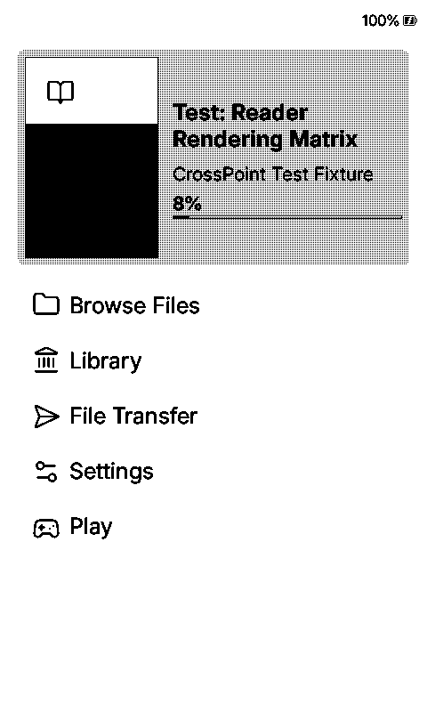
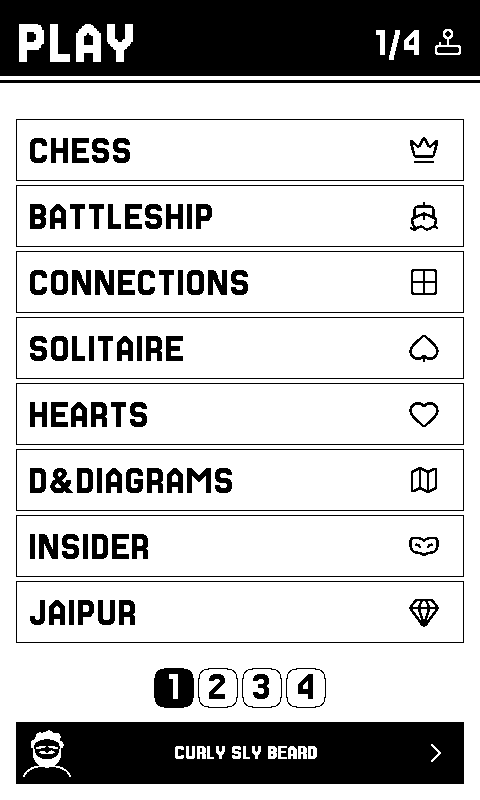
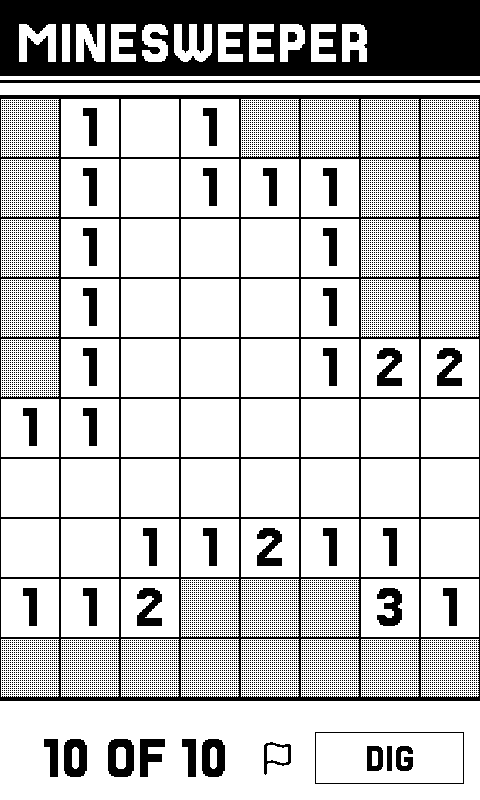

# CrossInk Play

CrossInk for reading, with a **Play** section containing the 25 games from
CrossPlay. This is a personal fork for the **Xteink X4 Pro (ESP32-S3, 16 MB
flash)**.

**Version: 0.1.0-alpha.1.** Based on CrossInk **v1.6.1** and CrossPlay
**v1.14.2**. The initial release is built and checked on a desktop; physical
X4 Pro testing is still required. Do not use its firmware on an X3, X4,
X4 Classic, or Sticky.

## Maintain and download

| Task | Open | Result |
| --- | --- | --- |
| Build the current firmware | [Build firmware](https://github.com/probablyangg/CrossInk-Play/actions/workflows/play-build.yml) | Choose **Run workflow** on `main`; download the tested X4 Pro package from the completed run. |
| Check CrossInk and CrossPlay | [Check upstream updates](https://github.com/probablyangg/CrossInk-Play/actions/workflows/play-upstream.yml) | Check both release feeds and prepare draft update pull requests when changes are available. |
| Add a game request | [Request a game](https://github.com/probablyangg/CrossInk-Play/issues/new?template=play-game-request.yml) | Record the game, source or rules, and desired controls for implementation. |
| Download a published build | [Downloads](https://github.com/probablyangg/CrossInk-Play/releases) | Download a packaged prerelease with its source revision and checksums. |

GitHub runs the builds and checks; a local compiler is not needed for these
actions. The upstream workflow is scheduled daily. Updates remain draft pull
requests until their changes are reviewed and tested; new games still need
code to be written or ported.

See [Easy maintenance](docs/play-maintenance.md) for the button-by-button flow,
the one-time GitHub settings, and installation of later builds.

## Preview

Actual X4 Pro simulator captures from the tested build:

| CrossInk Home | Play shelf | Minesweeper |
| --- | --- | --- |
|  |  |  |

## What changes

- A Play entry opens the game shelf from CrossInk's Home screen, including
  Minimal, Dashboard, and Cover Grid themes.
- CrossInk's reader, fonts, reading statistics, bookmarks, library, and
  reading settings remain the base implementation.
- Games use their existing SD-card save files and touch/button interfaces.
- The nearby multiplayer code is retained for games that support it.
- A normal sleep/wake can restore the game shelf or the last game; holding
  Back during wake preserves the reader's recovery route.
- Automatic upstream firmware updates are disabled in Play builds. Manual
  SD-card updates remain available after installing the Play partition layout.

## Games

Chess, Battleship, Connections, Solitaire, Hearts, D&Diagrams, Insider,
Jaipur, Sea Salt, Murdle, Checkers, Connect Four, Yahtzee, Knucklebones,
Minesweeper, Sudoku, Picross, Toy Battle, Forehead, Trivia, Wavelength, Go,
Hex, Underhand, and Wordle.

See [Games and data](docs/play-games.md) for game modes, downloaded data,
save locations, and features that require Wi-Fi or a second device.

## Install

Read the [CrossInk Play installation guide](docs/play-installation.md).
The first installation uses USB because Play has a larger application
partition layout. An application-only SD update cannot change that layout.

The standard CrossInk and CrossPlay installers install their respective
upstream firmware. Use the **CrossInk Play** package for this fork.

## Build

```sh
git clone --recurse-submodules https://github.com/probablyangg/CrossInk-Play.git
cd CrossInk-Play
python3 -m venv .venv
. .venv/bin/activate
python -m pip install 'platformio==6.2.0' -r requirements.txt
pio run -e x4-pro
python scripts/package_play.py
```

The FreeInk SDK and simulator are pinned to specific commits. Small checked
patches supply the storage APIs needed by the games; a mismatched dependency
stops the build. Play is only enabled in `x4-pro`, `x4-pro-debug`, and
`x4-pro-simulator`. The other device configurations retain upstream behavior.

The simulator additionally needs SDL2 development files, a C++ compiler, and
`sdl2-config` on `PATH`, plus OpenSSL development files on Linux (on
Debian/Ubuntu: `sudo apt-get install libsdl2-dev libssl-dev pkg-config`). Then:

```sh
pio run -e x4-pro-simulator
python scripts/run_simulator_smoke_test.py --env x4-pro-simulator --no-build --play --timeout 120
python scripts/run_simulator_smoke_test.py --env x4-pro-simulator --no-build --home-themes --timeout 90
```

Build firmware and simulator sequentially. PlatformIO can invalidate shared
build state when project configuration changes.

## Validation and limits

The imported game rules, persistence, multiplayer protocol, UI layout, and
runtime reveal gates have native checks in [host-tests-play](host-tests-play).
See [Validation](docs/play-validation.md) for the exact checks and remaining
hardware checks for this alpha.

Desktop tests cannot establish e-ink refresh quality, battery consumption,
physical touch calibration, SD-card timing, or ESP-NOW behavior on actual
radios. Normal game downloads also depend on their upstream services.

## Reader documentation

- [Reader features](docs/reader-features.md)
- [Controls](docs/controls.md)
- [SD-card fonts](docs/sd-card-fonts.md)
- [Reading statistics sync](docs/reading-stats-sync.md)
- [Nearby reading position sync](docs/nearby-position-sync.md)

## Credits and licenses

- [CrossInk](https://github.com/uxjulia/CrossInk), based on
  [CrossPoint Reader](https://github.com/crosspoint-reader/crosspoint-reader)
- [CrossPlay](https://github.com/ma-r-s/crossplay), source of the game code
- [FreeInk SDK](https://github.com/Free-Ink/freeink-sdk)

Original notices are retained. See [LICENSE](LICENSE),
[CrossPlay's MIT license](src/apps_local/LICENSE.CrossPlay),
[third-party notices](src/apps_local/THIRD-PARTY-NOTICES.CrossPlay.md),
and the licenses alongside the imported fonts and engines.
This fork is independent of those upstream projects.
